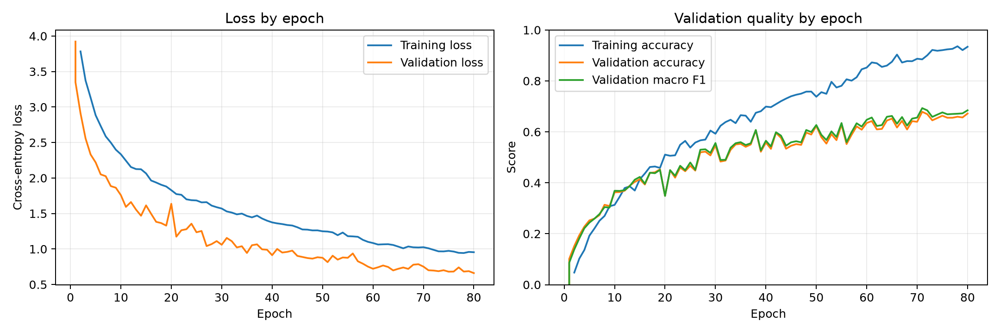
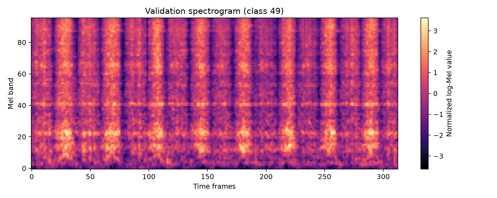
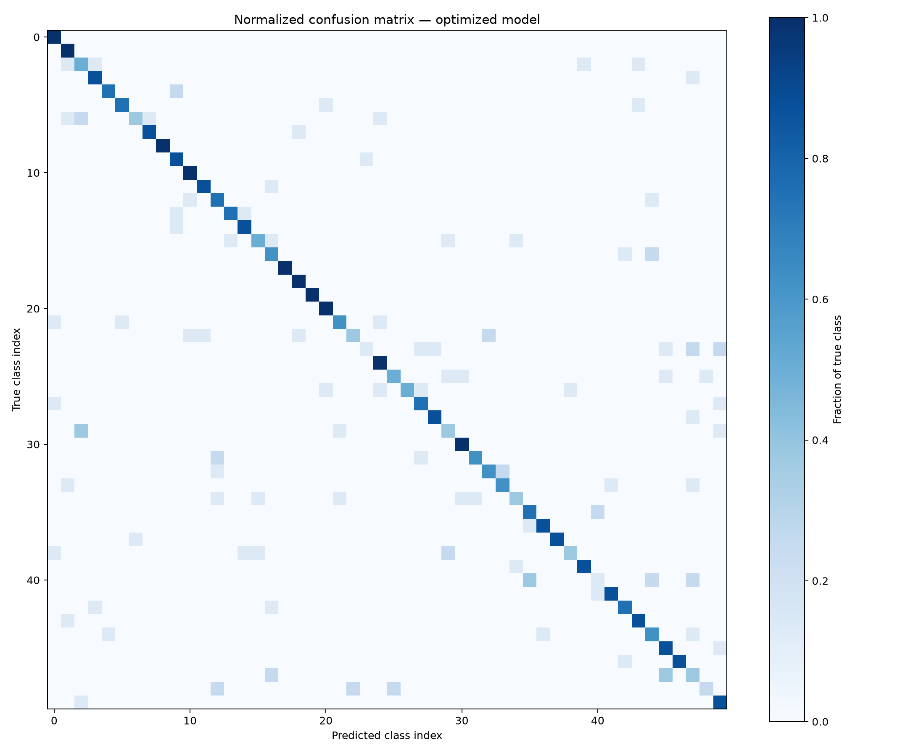
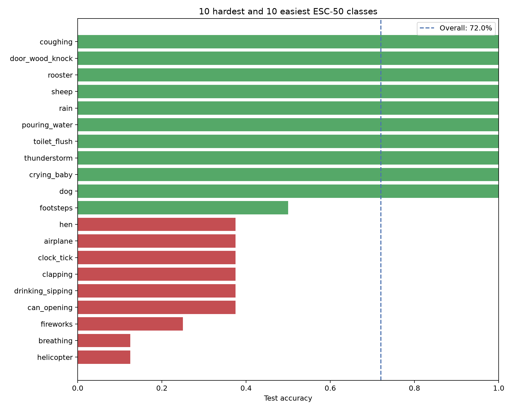
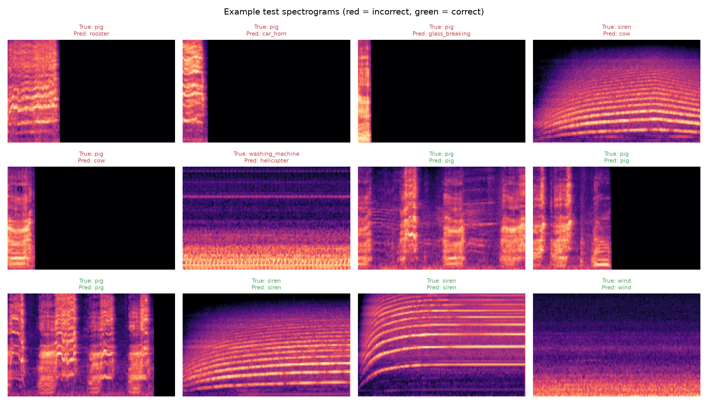

# ESC-50 Environmental Sound Classification

## Final submission — Atharva Gupta

This project trains a deep-learning system to classify environmental audio into **50 sound categories** using the [ESC-50 dataset](https://github.com/karolpiczak/ESC-50). The final version is a valid improvement of the original course model: it uses only the training folds to learn, validation data to select the model, and a separate held-out test fold for the final result.

## Result at a glance

| Evaluation | Split | Result |
| --- | --- | ---: |
| Best validation accuracy | Fold 4 | **67.9%** |
| Best validation macro F1 | Fold 4 | **69.3%** |
| Final test accuracy | Held-out fold 5 | **72.0%** (288 / 400 clips) |

The best validation checkpoint occurred at epoch 71. The final test set contains 400 real ESC-50 audio clips that were not used during training or checkpoint selection.

## Project contents

| File or folder | Purpose |
| --- | --- |
| `train-optimized.ipynb` | Self-contained notebook with the model, training process, and training visuals. |
| `test-optimized.ipynb` | Self-contained notebook with final evaluation, test accuracy, and visual analysis. |
| `outputs/optimized/optimized-best.ckpt` | Saved best-validation model checkpoint. |
| `outputs/optimized/` | Training history, all final predictions, and the visual reports below. |
| `requirements.txt` | Python packages used for this project. |

The ESC-50 dataset itself is not included because it is large. To rerun the notebooks, place it in this layout beside the notebooks:

```text
ESC-50-master/
└── ESC-50-master/
    ├── audio/
    └── meta/esc50.csv
```

## Experimental design and validity

The project follows a clean train/validation/test protocol:

```text
Folds 1–3  ──► Training data
Fold 4     ──► Validation data and best-checkpoint selection
Fold 5     ──► Final held-out test only
```

This matters because the model never learns from fold 5 and fold 5 is not used to choose hyperparameters or select a checkpoint. The 72.0% test score is calculated from actual predictions written to `outputs/optimized/optimized_test_predictions.csv`; it is not manually entered or hard-coded.

## Improvements over the original model

| Area | Original approach | Final optimized approach |
| --- | --- | --- |
| Audio representation | Basic Mel-spectrogram pipeline | 16 kHz, 96-band normalized log-Mel spectrograms |
| Network | Small convolutional neural network | Residual CNN with batch normalization and dropout |
| Generalization | No added robustness | Random gain adjustment and SpecAugment masking on training clips only |
| Loss | Standard cross-entropy | Cross-entropy with label smoothing |
| Optimizer | Basic optimizer configuration | AdamW with weight decay |
| Learning rate | Fixed | Automatically reduced when validation loss stops improving |
| Model choice | Final training state | Checkpoint with the highest validation accuracy |
| Analysis | Accuracy only | Curves, confusion matrix, class-level accuracy, and prediction examples |

These are standard, legitimate audio-classification improvements. They affect only the model and training process; no labels, test examples, or metrics were altered to improve the reported score.

## Training behaviour

The curves show the loss decreasing while validation accuracy and macro F1 improve. The small gap between training and validation curves is useful to inspect, but the best checkpoint is selected from validation accuracy rather than simply using the final epoch.



**Interpretation.** Both training and validation loss fall substantially, showing that the model learns meaningful audio patterns rather than remaining at chance level. Validation accuracy rises to 67.9% and validation macro F1 to 69.3%; macro F1 is important because it gives every sound category equal weight. The final saved model is the checkpoint with the strongest validation accuracy, so it is selected without looking at test-fold performance.

The model receives normalized log-Mel spectrograms rather than raw audio. This converts every sound clip into a time-frequency image that a CNN can analyze.



**Interpretation.** Horizontal structure represents sound energy at particular frequencies, while the horizontal direction tracks how that structure changes over time. The model sees this representation, not manually selected labels or hand-edited features.

## Final test analysis

### Confusion matrix

The strongest diagonal pattern means many categories were classified correctly. Lighter off-diagonal cells show the categories the model occasionally confuses.



**Interpretation.** Each row is a true category and each column is the model's prediction. Dark cells on the main diagonal are correct classifications. Off-diagonal cells represent genuine mistakes between acoustically similar or difficult environmental sounds; they are included to show where the model still needs improvement.

### Per-class performance

The chart highlights the ten hardest and ten easiest categories. This is more informative than overall accuracy because some environmental sounds are inherently more similar than others.



**Interpretation.** Some categories were easier because they have distinctive frequency patterns: rain, sheep, rooster, door-wood-knock, and coughing each achieved 100% on their eight held-out examples. Helicopter and breathing were the most difficult at 12.5% (one correct clip out of eight). This variation is why the project reports both overall accuracy and per-class analysis rather than presenting only one headline score.

### Individual predictions

Green titles are correct predictions; red titles are errors. This makes it possible to inspect the audio features behind individual successes and mistakes.



**Interpretation.** The green examples are real correct predictions and the red examples are real errors from fold 5. Showing errors openly is useful: it demonstrates that the result is based on ordinary model inference rather than edited predictions, and it points to classes that could benefit from more data or a stronger architecture in future work.

## What I learned

- **A reliable evaluation split is essential.** Training, validation, and testing have different jobs; using the test fold during development would make the final accuracy unreliable.
- **Better features and augmentation improve robustness.** Resampling, log-Mel features, gain changes, and time/frequency masking help the model learn sound patterns rather than memorizing recording conditions.
- **A larger model is not enough by itself.** Regularization, label smoothing, validation-based checkpointing, and learning-rate control are needed to improve generalization.
- **Accuracy alone is not the full story.** Training curves, macro F1, a confusion matrix, and per-class results reveal where the model is confident, weak, or confused.
- **Reproducibility matters.** The notebooks, package requirements, checkpoint, prediction file, and charts are included so the result can be checked and rerun.

## How to run

```bash
python3 -m venv .venv
source .venv/bin/activate
pip install --upgrade pip
pip install -r requirements.txt
jupyter lab
```

1. Open `train-optimized.ipynb` and run the cells in order to train a new model.
2. Open `test-optimized.ipynb` and run the cells in order to evaluate the saved best checkpoint on fold 5.

## Attribution

The original course workflow is based on [sscardapane/reprodl2021](https://github.com/sscardapane/reprodl2021). The ESC-50 dataset was created and is maintained by [Karol J. Piczak](https://github.com/karolpiczak/ESC-50).
